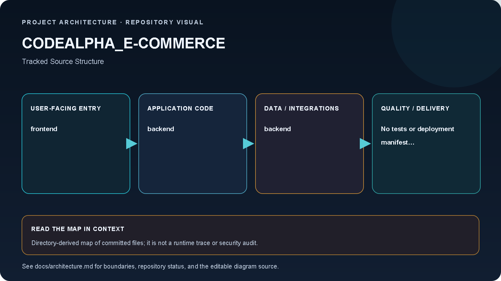
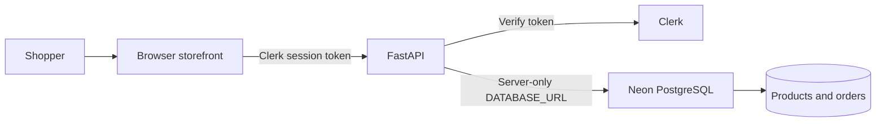

# CodeAlpha E-Commerce

A browser storefront and FastAPI API for a sample catalog, shopping cart, and orders. Clerk owns shopper identity; the API verifies Clerk session tokens. Neon stores products and orders. Product images are URL references only, so this prototype has no file-upload flow and does not use R2.
**Live link:** [https://codealpha-ecommerce-seven.vercel.app](https://codealpha-ecommerce-seven.vercel.app)

## Architecture



[Architecture notes](docs/architecture.md) · [Editable SVG](docs/images/codealpha-e-commerce-architecture.svg)




## Configure Neon and Clerk

1. Create a Clerk application and enable the sign-in methods you want.
2. Create a Neon PostgreSQL database.
3. Apply [`backend/migrations/0001_initial.sql`](backend/migrations/0001_initial.sql) in Neon SQL Editor or with `psql`.
4. Copy `backend/.env.example` to `backend/.env`; configure the Clerk publishable key, secret key, JWT public key, authorized frontend origins, Neon `DATABASE_URL`, and your administrator's Clerk user ID.
5. Keep `CLERK_SECRET_KEY`, `CLERK_JWT_KEY`, and `DATABASE_URL` in the backend only. The publishable key is returned through `/api/public-config` and is safe for the browser.

The former local-password user database is removed. Existing user rows cannot be safely mapped to Clerk identities automatically. Admin access is granted only to IDs in `ADMIN_CLERK_USER_IDS`.

## Local run and checks

Set the environment in `backend/.env`, then install and run:

```bash
python -m pip install -r backend/requirements-dev.txt
cd backend
uvicorn app.main:app --host 0.0.0.0 --port 7860
pytest -q
```

For tests and local development only, set `DATABASE_URL=sqlite:///./local-test.db`; the app creates and seeds that SQLite demo database. Production requires Neon and the checked-in migration. Configure the hosting environment with the same server-side variables before deploying.

This is a learning storefront, not a production payment system. It does not process payments.
