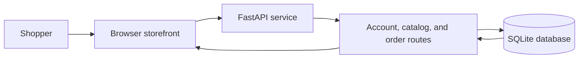

# CodeAlpha E-Commerce

<strong>A compact e-commerce prototype with a FastAPI service, product and order records, and a browser storefront.</strong>

Python · FastAPI · SQLite · HTML/CSS/JavaScript

## Project overview

The backend in `backend/app/main.py` serves the storefront and defines the API for user accounts, products, and orders. It creates SQLite tables for users, products, and orders. The `frontend/` folder currently contains the storefront entry page and its referenced static assets.

## Architecture

## Run and deployment status

The backend uses salted PBKDF2 password hashes, bearer headers, server-calculated order totals, atomic stock checks, bounded inputs, and configurable CORS (`CORS_ORIGINS`). Set `APP_DATA_DIR` to persistent writable storage. A first admin can be configured with `ADMIN_EMAIL` and a strong `ADMIN_PASSWORD` of at least 16 characters; an old default admin credential is disabled on database startup.

Build from the repository root with `docker build -f backend/Dockerfile -t codealpha-ecommerce .`. The container exposes port `7860`; mount persistent storage at `/data` or set `APP_DATA_DIR`.

This remains a learning prototype, not a production checkout service: sessions are held in process memory, and there is no payment processing, rate limiting, or multi-instance database setup. Do not handle real customer orders or payment data without those systems and a deployment review.

## Project media

- [Recorded demo](httpsca-ecommerce-phi.vercel.app.mp4)
- [Interface capture](httpsca-project-mgmt.vercel.applogin.png)

## Project structure

- `backend/app/main.py` — FastAPI app and SQLite setup
- `backend/requirements.txt` — Python packages
- `backend/Dockerfile` — container recipe (see build-context note above)
- `frontend/index.html` — storefront entry page
